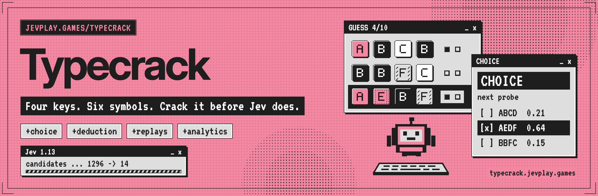
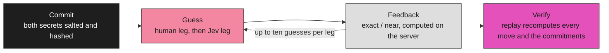

<p align="center"></p>

<div align="center">

# Typecrack

**Crack Jev's typed code, then defend yours.**

[](LICENSE)
[](package.json)
[](package.json)
[](https://typecrack.jevplay.games)

[Quick start](#quick-start) · [How it works](#how-it-works) · [What is included](#what-is-included) · [Verification](#verification-commands) · [Layout](#repository-layout) · [Contributing](#contributing)

</div>

---

Typecrack is a two-leg code-breaking duel against Jev: four positions, six symbols (A–F), repeats allowed, ten guesses each. It is a runnable, framework-free game with a server-authoritative backend, Discord integration, replay verification and exhaustive post-match deduction analytics.

> [!NOTE]
> Live TypeSafe inference, real Discord authorization/installation and Cloudflare deployment were **not** executed with production credentials; those boundaries are exercised with controlled fixtures. See [the packaged validation report](reports/VALIDATION.md) for exact completed checks and limitations. The managed Chromium used to build the package blocked ordinary URL navigation, so an offline DOM + real Web Worker + loopback-API bridge suite exercised the interface instead. It did not substitute for native browser cookie, CSP or CORS validation; a normal Playwright HTTP-origin suite is provided for staging.

## Quick start

Node.js 22.16 or later is required. No package installation, external account or API key is needed for local play.

```sh
cd jev-typecrack
npm start
```

Open **http://127.0.0.1:8787**. Use this exact address, not `localhost`: the development server validates the Host header. Stop with Ctrl+C. Its SQLite database is created automatically at `.data/typecrack.sqlite`; a database created there before the rename keeps being used. Node may display an experimental SQLite warning.

The default opponent is a local solver and is never presented as Jev: its board is titled **Local solver**, the header reads **LOCAL OPPONENT / NOT JEV**, and match analytics name it **Local solver, not Jev**. Local matches never enter official rankings. To call real Jev, copy `.env.example` to `.env`, provide `TYPESAFE_API_KEY`, and restart. This enables real provider calls but **does not enable ranked play on the loopback development server**. See [deployment](docs/DEPLOYMENT.md) for trusted public deployment and Discord setup.

Choose a four-symbol code, then break the server's independently generated code. Jev subsequently breaks yours. Feedback is **exact / near**: a correct symbol in its correct position versus a correct symbol in a different position, without double-counting repeats. Lower codebreaking cost wins; an unsolved leg costs 11. Equal costs draw. No time bonuses or arbitrary points.

Click slots and palette buttons, or use A–F, arrow keys, Backspace and Enter. A repeated submitted guess consumes an attempt; an HTTP retry does not. Full human move analysis unlocks only after the match finishes. Browser practice also works when an already loaded page cannot reach the API; it stores no official scores and does not claim to be Jev.

## How it works



Both codes are locked behind salted SHA-256 commitments before the first guess. The server holds the secrets and computes all feedback. Jev receives only its own guesses and feedback plus a finite, pre-scored candidate set, never your code or your leg. When the match ends the secrets are revealed and the replay can be re-verified offline with `npm run verify`.

### What “exhaustive” means here

Every post-match move can be compared against **all 1,296 legal guesses**, with exact one-step partition calculations. The optional alternatives export includes a row and feedback distribution for each of those guesses at every played turn. The included baseline benchmark visits **all 1,296 possible secrets for each of eight policies**: 10,368 complete codebreaking runs.

This is exhaustive over the implemented finite configuration, not a claim that every possible UI race, production environment, human behavior, or multi-step optimal strategy has been proved. Candidate-set analytics use a uniform reference distribution, not an inferred human prior.

## What is included

| Area | Implementation |
|---|---|
| Game | Four positions, six letter-coded symbols, repeats, ten guesses, human and Jev alternate codebreaking legs |
| Opponent | Four bounded difficulty policies; real TypeSafe HTTP adapter; forced/local/fallback decisions explicitly separated |
| Analytics | Per-turn deduction, entropy, expected and realized information, exact partitions, all-1,296-guess counterfactual comparisons, reliability and timing |
| Exports | Full match JSON; played moves, decisions, and **every legal alternative at every turn** as CSV; replay JSON; retained account record |
| Identity | Discord `identify` OAuth, rotating secure sessions, signed guild/channel launch interactions |
| Ranked results | Server-held secrets, immutable salted commitments, authoritative feedback, replay verification, idempotent updates |
| Standings | World, Server, Channel; separate configuration/difficulty cohorts; established/provisional records and shared ranks |
| History | Account/session totals, wins/losses/draws, penalized guesses, streaks, 90-day UTC activity, paginated retained history |
| Operations | Redacted events, bounded durable quotas, leased AI calls, retry/fallback auditing, recovery/retention task |
| Evidence | Tests, exhaustive feedback verification, actual finite-space baseline results, raw data, screenshots, example exports |

Replays and commitments created before the Typecrack rename (legacy game id and commitment label) still verify; `tests/rename-compat.test.mjs` proves it against a real pre-rename replay. The rename also bumped the prompt version to `mm-prompt-v2`, which starts a new configuration cohort: pre-rename matches drop out of the default leaderboard and community views but stay reachable with `?configId=` (see [docs/ANALYTICS.md](docs/ANALYTICS.md#9-community-and-leaderboard-analytics)).

### Verification commands

```sh
npm test
npm run test:exhaustive
npm run bench:smoke
npm run bench:exhaustive
npm run verify -- reports/examples/sample-replay.json
```

These commands need only Node and the source tree. The finite-space benchmark can consume significant CPU for tens of seconds or longer depending on hardware. Its counterfactual cache reduces repeated calculations without changing choices.

Optional browser/deployment tooling requires network access:

```sh
npm ci
npx playwright install chromium
npm run test:browser
```

`@playwright/test` and Wrangler are development dependencies only, pinned by `package-lock.json`; nothing is bundled into the browser.

## Repository layout

| Path | Contents |
|---|---|
| `public/` | Static UI (`index.html`, `game.js`, `labels.js`, `game.css`), shared brand files, art |
| `assets/` | README banner, GitHub social preview, and their HTML sources plus the offline renderer (`node assets/src/render.mjs`, which also writes `public/brand/og.png`) |
| `public/typecrack/` | Pure rules, strategy, analytics and replay verification shared by browser, server and benchmark |
| `server/` | Worker entry, API, Jev adapter, Discord and auth integrations, Node development server |
| `schema/` | D1 migration |
| `tests/` | Native, exhaustive and browser suites |
| `bench/` | Finite-space benchmark harness |
| `scripts/` | Replay verification and Discord command registration |
| `reports/` | Generated evidence: benchmark results, examples, screenshots |
| `docs/` | Analytics dictionary, architecture, API, deployment, security, testing, sources, traceability |

Documentation: [analytics dictionary](docs/ANALYTICS.md) and [field inventory](docs/analytics-field-inventory.json), [architecture](docs/ARCHITECTURE.md), [API contract](docs/API.md), [deployment and Discord runbook](docs/DEPLOYMENT.md), [Discord Activity](docs/ACTIVITY.md), [security](docs/SECURITY.md), [testing and benchmarking](docs/TESTING.md), [sources](docs/SOURCES.md), [traceability](docs/TRACEABILITY.md), [measured baseline results](reports/benchmark-exhaustive/README.md).

All example game exports were generated by scripted local play. They are not human-study data, real Discord accounts, or live Jev measurements. No real credentials, session database, or installed dependencies are included.

## Contributing

Read [AGENTS.md](AGENTS.md) first. Bump rules, policy, prompt or config versions when behavior changes; never relabel existing cohorts. Run `npm test`, `npm run test:exhaustive`, the browser suite and `npm run bench:smoke` before opening a pull request, and regenerate reports from real runs rather than editing them.

---

<div align="center"><sub>A jevplay.games game · Steward: CompleteTech LLC · MIT licensed<br>Not an official TypeSafe AI publication; the pink, ink and pixel-window styling is a nod to typesafe.ai. Jev, System One and TypeSafe are their respective owners' names.<br>Typecrack is inspired by the classic code-breaking game; not affiliated with or endorsed by Invicta or Pressman.</sub></div>
